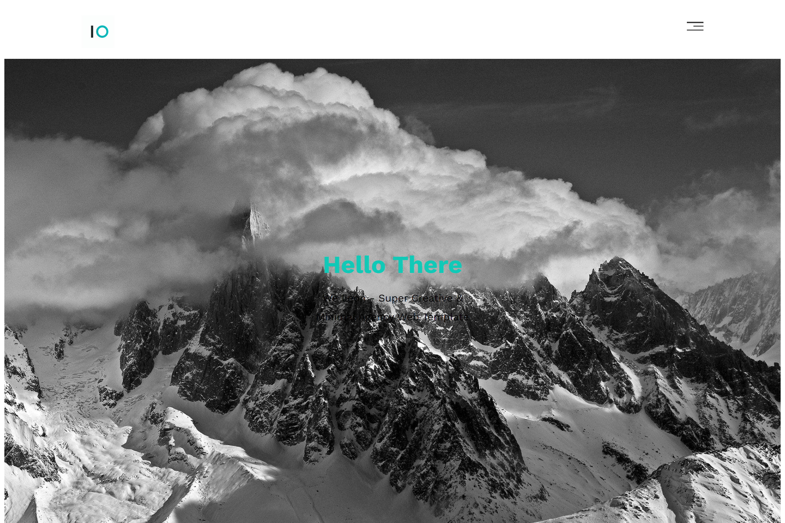
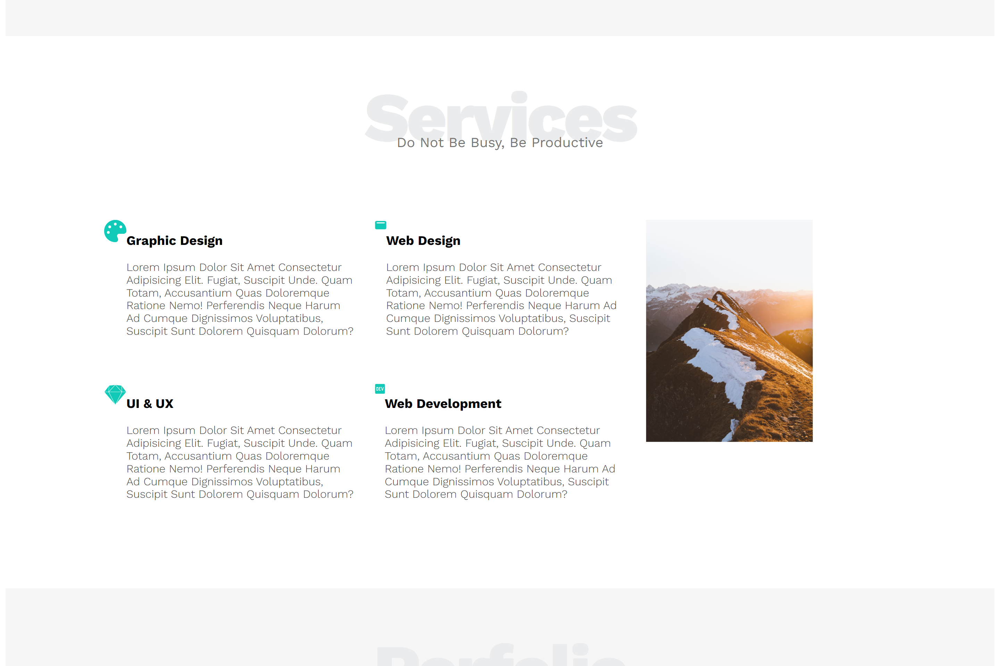
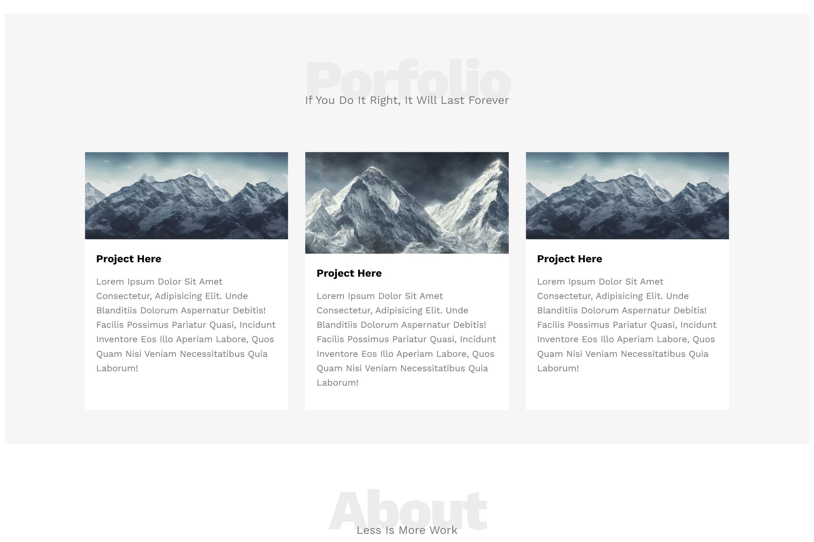
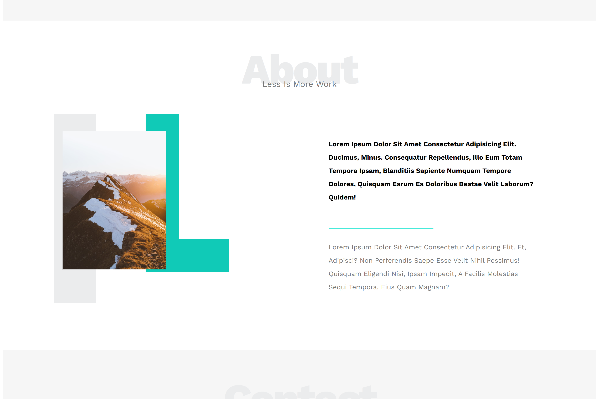
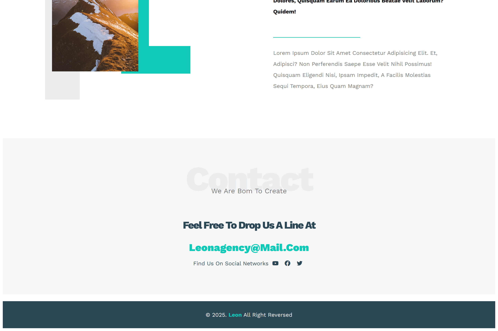

# Leon - Responsive Landing Page

My first frontend project, built during my early journey of learning web development.

## About The Project

Leon is a creative agency landing page designed to practice and improve my skills in building responsive web interfaces using HTML and CSS.

## Technologies Used

- HTML5
- CSS3
- Font Awesome

## Features

- Responsive layout for different screen sizes.
- Clean and modern user interface.
- Custom navigation bar.
- Hero section with a background image.
- Structured page sections.

## Project Purpose

This project was created as a practical exercise to apply HTML and CSS concepts, improve layout skills, and understand responsive web design.

## Screenshots

## Author

Created as my first frontend practice project.
